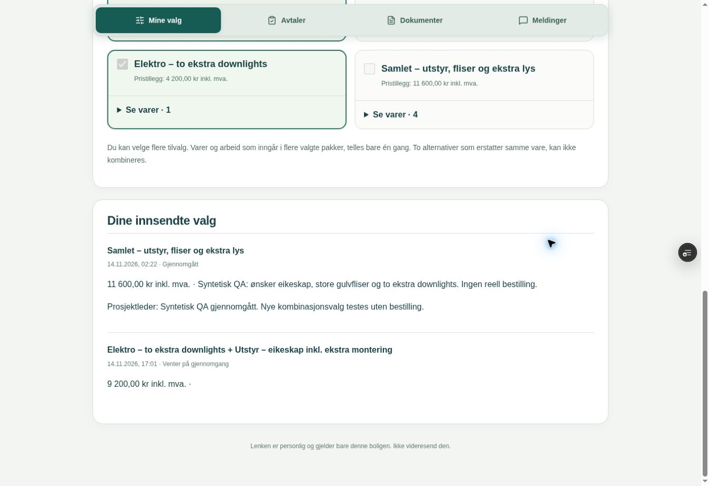
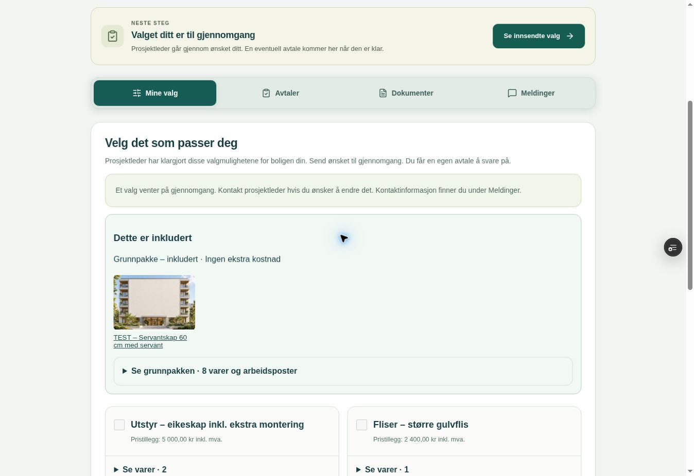

# Beboerportal: komplett bad mot vanlige tilbud – 14.11.2026

Miljømål: SANDBOX/DEMO. Oppdrag: selvstendig realistisk UX-test mens systemeier er borte.
Appkandidat PR333: 5249cf0bbe88a81f4d65f90ac36c31621ea8ca0b.
Fast preview: https://expo-proffdok-git-feat-bolig-partner-commerce-20261113-ringside.vercel.app/?progressTest=safe
Sandbox: ppvircenkjizeiqdxphj. Main/produksjon uendret. Ingen appkode eller tilgangsregler endret i denne testen.

## Konklusjon
Den tidligere testen med én vare skjulte reelle begrensninger. Flere varer gjør ikke automatisk beboerportalen lik ordinære tilbud. Eksisterende flyt virker for ferdige pakkealternativer, men er ikke tilstrekkelig som selvbetjent kombinasjon av utstyr, fliser og elektro. Ikke betrakt den utvidede beboer-UX-en som godkjent for dette brukstilfellet.

## Syntetisk prøveoppsett
Nytt prosjekt: QA – Komplett bad og tilvalg 14.11, referanse QA-FULL-PORTAL-20261114.
Én bolig H0101; kontakt qa-full-portal@example.invalid. Eksisterende Kenneth-mailtest ble ikke endret.
Grunnpakke: servantskap60cm, batteri, dusjvegger, toalett, gulvflis8m², veggflis24m², tak-/speillys og standard montering. Åtte poster. Testpriser, ikke kommersielle produktpriser.
Bilde-URL ble satt på grunnpakkevare og to alternativer, med eksisterende auth-bathroom.jpg som tydelig testillustrasjon, ikke produktfoto.

| Alternativ | Beregning inkl. mva. | Forventet og faktisk |
| --- | --- | --- |
| Grunnpakke | Inkludert | 0 kr tillegg |
| Eikeskap80cm + ekstra montering | 8500 − 5000 grunnfradrag + 1500 montering | 5000 kr |
| Større gulvflis | 5600 − 3200 grunnfradrag | 2400 kr |
| To ekstra downlights inkl. montering | Samlet tilvalgspris | 4200 kr |
| Alle oppgraderinger samlet | 5000 + 2400 + 4200 | 11600 kr |

Opprettet gjennom eksisterende autentiserte bolig-RPC-er; ingen DDL, direkte tilgangsutvidelse eller nye migrasjoner.

## Faktiske kontroller
1. Åpnet reell publisert portal fra PR333-preview, fem pakkealternativer og riktig bolig.
2. Valgte eikeskap, deretter ekstra lys. Bare lys sto valgt; eikeskap ble avvalgt. Dette er faktisk radio-/ett-pakkevalg, ikke uavhengige tilvalg.
3. Utvidet grunnpakke og elektro. Riktig navn, SKU, mengde/enhet; grunnvarene gjentas i hvert komplett alternativ. Ingen produktbilder rendres i valgkortene (DOM-antall0), selv med bildegrunnlag. Kildekontroll av BoligPortalPage bekrefter tekstliste uten bildemapping.
4. Valgte forberedt samlepakke og skrev syntetisk merknad. Hent siste status bevarte valg og tekst. Se over valget viste11600kr.
5. Send valg til gjennomgang ga tydelig kvittering. Ekte manager-RPC viste nøyaktig én pending request, samme total1160000øre. Full omlasting beholdt valgt pakke og innsendt merknad.
6. Ingen avtale ble opprettet/akseptert. DB-kontroll: commercial_documents0 og resident_link_mail0 for testprosjektet. Global residentmail er fortsatt pauset.
7. Desktop1363px: dokumentbredde1348px. Smal CSS-visning via nettleserzoom545px/doc539px og340px/doc337px: ingen horisontal overflow. Dette er ikke fysisk mobil/Safari eller touch-test. Lange åpne varekort krever mye vertikal scrolling.
8. Meldinger var avslått. Mine valg sier likevel «Send en melding hvis du ønsker å endre det». Meldinger-fanen forklarer korrekt at funksjonen er av og tilbyr e-postkontakt. Veiledningen bør følge faktisk aktivering.
9. «Se innsendte valg» aktiverer Mine valg, men førte ikke direkte ned til kvitteringen ved den observerte smale visningen. Test målrettet fokus/scroll i oppfølgingsendringen.
10. Åpnet eksisterende DEMO-03-TILBUD via Befaring/Tilbud → Se kundens tilbud. Reell kundeside viser faggrupper, individuelle opsjoner, prisforklaringer, monteringsposter, bilde-/større-bilde-lenke og totalsammendrag. Tilbudet var utløpt og opsjoner deaktivert; ingen aksept/ny publisering eller interaktiv prisendring ble utført der. Sammenligningen er visuell og kildebasert, ikke ny end-to-end-test av tilbudsaksept.

## Prioriterte funn
- Høy: uavhengige ønsker kan ikke kombineres av beboer. Manuelt forhåndsoppsett av kombinasjoner skalerer dårlig og gjør butikkarbeidet unødvendig tungt.
- Høy: bilder, hva som erstattes, grunnfradrag og eventuell monteringspris er ikke tydelig presentert i valglisten. Riktig sluttsum alene forklarer ikke hva kunden kjøper.
- Middels: grunnpakke fremstår som enda et radiovalg med «Tilvalg:0kr»; ønsket tydelige «Dette er inkludert»-seksjon mangler.
- Middels: hele grunnlisten gjentas i hver pakke. Ingen oversiktlig sortering av uavhengige valg under Utstyr/Fliser/Elektro i denne flyten.
- Middels: sendingskvittering og endringsveiledning bør ha direkte navigasjon og følge om meldinger er aktivert.

## Konkret neste implementering
Avgrens til beboerportalens valgvisning og nødvendig validert prosjektbundet kombinasjonsmodell. Bevar vanlig tilbudsmodul og eksisterende butikktillegg/aksept.
Vis grunnpakken én gang med bilder og mengder. Grupper alternativer per fag/produkt; bruk ett valg innen gjensidig utelukkende erstatninger og uavhengige avkrysninger for tillegg. Vis «erstatter», fradrag, varetillegg, montering og samlet tillegg inkl. mva. Sammenlign bilder og spesifikasjon før innsending.
Dette kan ikke løses trygt bare ved å bytte radio til checkbox: dagens server mottar ett offer_id med ferdig snapshot. Kombinasjoner må valideres på server med tillatte valg, konflikter/avhengigheter, pris, frist, revisjon og eksakt retry. Beboerønske og bindende avtale må fortsatt skilles.

Gjenbruk dette testprosjektet i neste retest. Kontroller utstyr+lys uten fliser, fliser alene, alle, tilbake til standard, alternativbytte med fradrag, avhengig montering, endret pris under åpen side, frist, tilbakekalt lenke og akseptert historikk. Sammenlign også mobilhandlinger og fokus.
Ingen produksjonssetting før UX-rettelsen er vurdert/testet og systemeier har gitt TEST OK. Historikken og den syntetiske testen beholdes; ingen hemmelige portallenker/token lagres i GitHub.

## Oppfølging: kombinerbare valg og grunnpakkebilder

Appkandidat: `66c932367f05a21bfe12fe04b92d42135f1e96ca`, PR333. Fast preview bekreftet READY på denne SHA-en. Main/produksjon og demo-branch er ikke endret. Sandbox `ppvircenkjizeiqdxphj` har fått bare den nye migrasjonen `bolig_portal_combined_choices`, remote-versjon `20261114155625` (lokal fil `20261114153617`). Ikke installer på nytt.

- Lokal PostgreSQL: 1966 assertions PASS. Kombinasjons-React, eksisterende butikk/staff-React, scope55 og build PASS. Ny regresjon hindrer en villedende 0-kroners kladdsum mens et valg venter på gjennomgang.
- Hosted: grunnpakke én gang, synlig bilde og samme bilde i full vareliste (naturalWidth1536), uavhengige utstyr/elektrovalg, sum9200kr, overlappende samlepakke11600kr uten dobbelttelling, fratrekk8500−5000=3500 og montering1500 separat. Valg bevart ved full reload. Ny kandidat testet etter eksakt READY-verifisering.
- Faktisk innsending fra nettleser lagret én ny pending request med to valgte tilbud og920000øre. Ingen avtale akseptert, ordre eller e-post sendt. Eldre syntetisk request markert reviewed gjennom vanlig manager-RPC før testen; historikken beholdt.
- Mobil kontroll: nettleserzoom400%, viewport340 CSS-piksler, dokumentbredde337. Ingen horisontal overflow, grunnpakke og innsendte valg lesbare. Dette er ikke en fysisk mobiltest.
- Den gamle QA-bildelenken `/auth-bathroom.jpg` dekodes ikke av nettleseren. En eldre kataloglenke svarte Bucket not found. Kun QA-portalens upubliserte snapshots fikk fungerende eksisterende fasadeillustrasjon før ny publisering; dette er en teknisk testillustrasjon, ikke et korrekt produktfoto. Frontend viser nå «Bilde utilgjengelig» ved bildefeil fremfor en tom bildelenke. Produktbilder må være tilgjengelige på registrerte adresser. Opplasting av et nytt produktfoto er ikke verifisert i denne runden.
- Faktisk database: combine-helper kan ikke kjøres av anon. Mail enabled=false. Advisor har eksisterende generelle advarsler, ingen funn som navngir de nye private helperne; dette er ikke en erklæring om at hele databasen er uten advarsler.
- Den interne nettleserøkten var utlogget. Managerens nye publiseringsvelger er derfor lokalt kontrollert, men ikke klikket gjennom som innlogget bruker denne runden. Publisering/republisering er verifisert gjennom autentisert manager-RPC i sandbox. Prosjektbundet butikktilgang er uendret fra tidligere hosted QA.

CI43613148438: bolig-db, bolig-browser, scope, build, company-db, HR og projects-support grønne ved dokumentering; app-browser/sluttkontroll feilet fordi ny veiledning ikke var registrert i testens liste over tilføyde temaer (70 mot69 originaltemaer). Testlisten er nå utvidet med det konkrete nye temaet og en kontroll av teksten; alle69 opprinnelige teksthashene og øvrige innholdskontroller beholdes. Ny CI må bekreftes. Ikke merge før samlet CI er grønn og TEST OK er gitt. PR332 er fortsatt separat; ny kombinert332+333-kontroll gjenstår før samlet produksjonssetting.

Neste steg: kontroller endelig CI, innlogget publiseringsvelger og et faktisk opplastet produktfoto. Deretter TEST OK. Ved rollback: slå av kombinasjonsmodus via ny publisering og tilbakefør frontend; bevar migrasjon og innsendt historikk. Ingen hemmelige portallenker er lagret i GitHub.

## Sluttkontroll: opplastede private bilder (14.11)

Denne statusen erstatter de åpne punktene i forrige oppfølging. Appkandidat `4c037f66e0df99b8ea290a923aa624dfaf798cba`, eksakt fast PR333-preview bekreftet READY. Produksjon/main og demo-branch er urørt.

- Innlogget manager: publiseringsvelger klikket gjennom. Endring av modus nullstiller gjennomlesingsbekreftelsen og sperrer publisering inntil ny bekreftelse. Republisering bevarer kombinasjonsmodus. Ingen e-post ble sendt.
- Faktisk UI-opplasting gjennom Bytt bilde, lagring av grunnpakkeversjon2 og gjenåpning PASS. Brukt eksisterende fasadeillustrasjon som syntetisk testbilde, ikke et produktfoto.
- Opplastinger lagres privat. Ny Edge `bolig-portal-images` gir bare kortvarige signerte adresser til bilder fra den aktive portalens egne publiserte tilbud og samme firma/prosjekt. Ingen offentlig bucket eller firmatilgang utvidet. Filtrering gjentas etter signering for å fange tilbakekalling/endring. Utstedte bildeadresser kan leve i maksimalt120sekunder etter tilbakekalling; frontendcache60sekunder.
- Sandbox-migrasjon `bolig_portal_image_access` installert som `20261114162258` (lokal fil `20261114161925`). Edge versjon1 ACTIVE. Kombinasjonsmigrasjonen er allerede installert som `20261114155625`. Ikke installer på nytt.
- Faktisk HTTP: gyldig portal gir200 og ett tillatt bilde, signert bildeadresse gir200 og JPEG. Ugyldig token403, klientstyrt bildepath400.
- Faktisk beboerportal: opplastet bilde vises både i grunnpakkens miniatyr og utvidet vareliste, naturalWidth1536. Ny full omlasting etter cachelevetiden viser fortsatt bildet. Ingen innlogging kreves for beboerens gyldige lenke.
- Smal CSS-visning340px, dokument337px: ingen horisontal scrolling. Desktop1363px kontrollert. Dette er nettleserzoom, ikke fysisk telefon/Safari.
- PostgreSQL1969 assertions, Edge/client-bilderegresjon, kombinasjons-React og build PASS lokalt. Full CI43615445115 grønn på appkandidat4c037f66, inkludert app-browser, bolig-browser, databasepakker, bygg og sluttkontroll
- Post-DDL security advisor: ingen funn navngir de nye image_paths/portal_image-funksjonene; eksisterende generelle databasevarsler gjenstår. Privat bucket bekreftet public=false, residentmail fortsatt enabled=false.
- Isolert sammenslåing av PR333 `4c037f66` og PR332 `f25118e6`: bygg og PostgreSQL1989 assertions PASS. Tre tekstkonflikter løst lokalt med begge funksjoner bevart: fokus/scroll + dato/klokkeslett i portal, begge README-tillegg og alle12 nye hjelpetemaer med ny fristtekst. Ingen branches merget eksternt. `PR332_PR333_RESOLUTION_20261114.patch` dokumenterer de tre løste filene relativt til PR333-kandidaten; brukes kun etter ny kontroll av gjeldende heads. Kombinert browser-QA er ikke kjørt på en egen publisert integrasjonsversjon.

Neste steg: systemeiers TEST OK før egen kontrollert produksjonsplan. Sandbox er eneste database endret i denne leveransen. Produksjonsplanen må inkludere de nye migrasjonene og Edge-funksjonen i riktig rekkefølge, kontrollert mot hva som allerede er installert. Ved tilbakeføring: deaktiver kombinasjonsmodus via publisering, tilbakefør frontend og ny Edge ved behov, men behold migrasjoner, private bilder og innsendt historikk. Ingen hemmelige portallenker eller token lagret.
